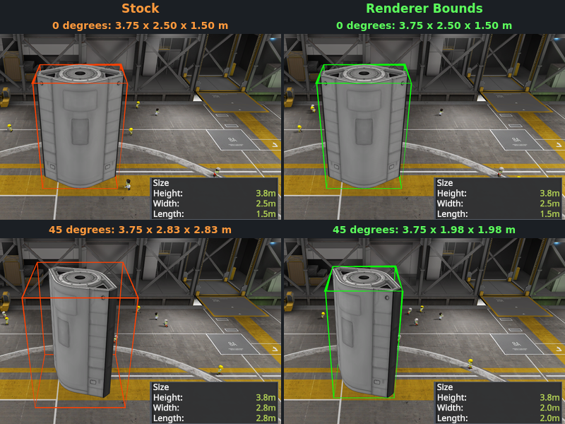
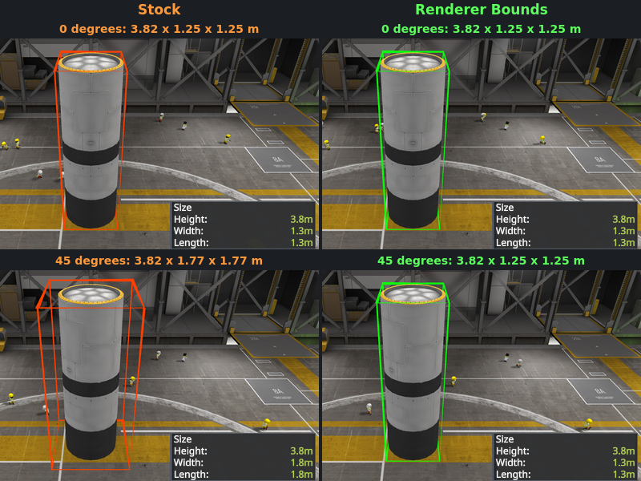
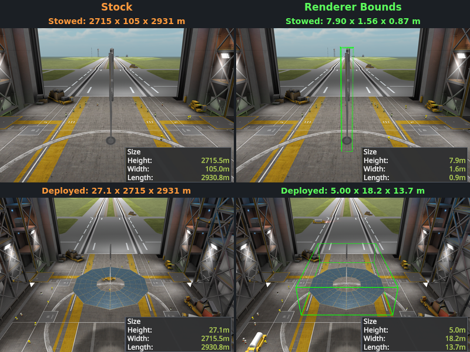
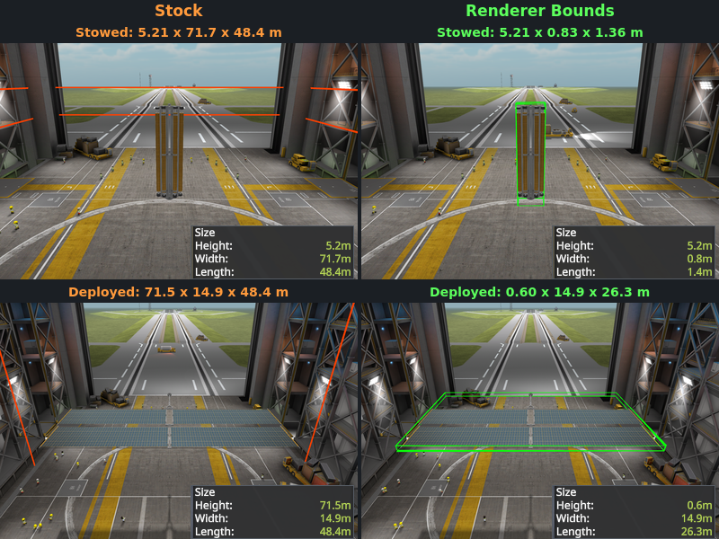

# Renderer Bounds

Measures craft size from part mesh geometry instead of inflated axis aligned renderer bounding boxes.

## Screenshots

## Why?

KSP's craft size calculations use axis aligned bounding boxes around each part. This isn't a problem, since only the axis aligned dimensions are counted.

Except that's not true. The bounding box that counts in world coordinates is around the bounding box of the part in its own local coordinates, so if you rotate a part 45 degrees then its world dimensions will increase by 41% even if the part is a cylinder.

Except that's still not true. The part's bounding box is calculated from the bounds of each mesh, and each mesh can have its own rotation transform. So a cylinder mesh that's been rotated 45 degrees will increase the part's dimension by 41%, then if you rotate the part 45 degrees that compounds *another* 41%, for a total of +100% to the size of the part.

I created this mod because I was tired of 1.25m tanks making my craft 1.8-2.5m wide, so they wouldn't fit in my 2x2m LC, among many other less straightforward failure modes.

## Why else?

An ordinary mesh gets its box from its own vertices, so rotation is its only problem. A skinned mesh with joints and animations does not. Its bounding box is stored in the model file and used as is, regardless of the mesh pose. Some parts measure too small when deployed. Some read too large when undeployed. Some are always wrong, and some of those wildly so.

With Renderer Bounds, a part's dimensions will always match its current pose. Some examples from a survey of a large RP-1 install, unrotated and stowed, largest dimension unless noted:

| Part | Mod | Stock | Renderer Bounds |
|---|---|---|---|
| Communotron 88-88 (`commDish`) | Squad | 2.13 m | 1.28 m |
| MG03 Fluxgate Magnetometer Boom | RP-1, ReStock model | 1.69 m | 0.80 m |
| IKU-03 Kerbal Safety Bubble, height | VenStockRevamp | 3.83 m | 2.01 m |
| Adjustable HIAD | ROHeatshields, ReStock model | 14.19 m | 2.66 m |
| Blanket Solar Panel, ReStock Gigantor design | ROSolar | 8.68 m | 2.21 m |

Some solar panels have baked in bounds tens to thousands of meters too large:

| Blanket Solar Panel design | Stock | Renderer Bounds, retracted | Renderer Bounds, extended |
|---|---|---|---|
| ARM | 2,931 m | 7.90 m | 18.22 m |
| BFS | 81.17 m | 0.92 m | 15.60 m |
| DSG | 75.27 m | 4.91 m | 22.09 m |
| DST | 71.68 m | 5.21 m | 26.34 m |
| DRM | 69.71 m | 5.88 m | 30.29 m |
| Starship | 30.93 m | 1.57 m | 6.98 m |
| Orion | 6.28 m | 1.02 m | 1.89 m |

In a few cases, like the extended BFS solar panel, Renderer Bounds accurately reports a larger size than the stock box.

## How?

Renderer Bounds measures the part's renderers (effectively the meshes) from their actual vertices, using a convex hull of each mesh, so a rotated part measures its true extent. For an ordinary mesh that is never larger than before. A skinned mesh (ladders, folding solar panels, etc) is measured from its current pose, which its stock bounding box can lag behind.

It changes the bounds that every user of `PartGeometryUtil.GetPartRendererBounds` sees: craft size and the size limit checks, the Engineer's Report, cargo bay and inventory fit, and craft thumbnails.

Which renderers count is unchanged. KSPCommunityFixes and RP-1 each discount certain renderers, and they will continue to do so with this mod enabled.

## Minutiae

Set `enabled = false` in `GameData/RendererBounds/Settings.cfg` to turn it off.

Craft files store their size when saved, so an existing craft shows its old size until it is saved again in the editor.

## Installing

Install with [CKAN](https://github.com/KSP-CKAN/CKAN), or download the latest zip from [releases](https://github.com/sparr/ksp-mod-RendererBounds/releases) and copy `GameData/RendererBounds` into your KSP `GameData` folder.

Requires KSP 1.12 and [Harmony](https://github.com/KSPModdingLibs/HarmonyKSP).

## Building

You need the [.NET SDK](https://dotnet.microsoft.com/download) (8 or later) and a KSP 1.12 install.

1. Clone with `git clone --recursive`, or run `git submodule update --init` in an existing clone.
2. Copy `RendererBounds.props.user.example` to `RendererBounds.props.user` and set the path to your KSP install. Alternatively, set the `KSP_ROOT` environment variable.
3. Run `dotnet build`.

The plugin is written to `GameData/RendererBounds/Plugins/`. Run `./install.sh` to copy the mod folder into the KSP install.

`dotnet test test/RendererBounds.Tests` runs the unit tests.

## License

MIT. See `LICENSE`.

`src/RendererBounds/ThirdParty/QuickHull3D/` is a git submodule of [QuickHull3D](https://github.com/BioFluidix/QuickHull3D), BioFluidiX's MIT-licensed C# port of [John E. Lloyd's QuickHull3D](https://www.cs.ubc.ca/~lloyd/java/quickhull3d.html). Its license and Lloyd's notice ship in the mod folder as `THIRD-PARTY-NOTICES.md`.
